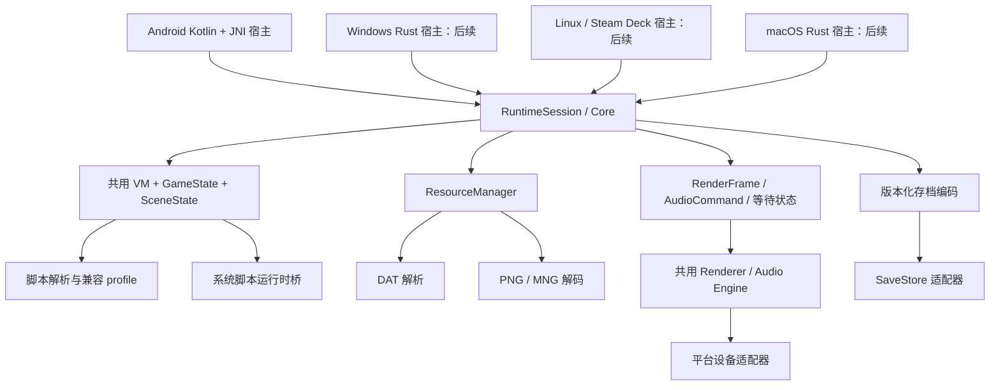

# NekoPack Cross-Platform Runtime 架构提案

日期：2026-11-06。状态：**方案已获用户审核通过，按最小迁移批次执行**。以下现状为实施前审查快照；M1 最新结果见 [标题执行链路](docs/Phase2_Title_Runtime.md)。

审查基线为 `e6c38e3b38bd975014b1e1f8d982870c7751ff6c`，同时包含当前工作区尚未提交的变量/调用状态机、Squirrel 桥和无窗口标题测试宿主。它们不是已经验收的正式功能。详细发现见 [平台依赖审计](PLATFORM_DEPENDENCY_AUDIT.md)，实施顺序见 [迁移计划](MIGRATION_PLAN.md)。

## 1. 决策摘要

采用“一套引擎核心、多种薄宿主”。Android ARM64 仍为第一个交付目标；Android MVP 成功后优先增加 Windows 宿主，再扩展 Linux/Steam Deck、macOS。当前不同时建设五个平台。

保留现有 DAT、资源来源解析、PNG/MNG 与脚本解析代码。重点是将新增执行代码与系统脚本桥、文件访问、设备能力分开，而不是重写已验证的解析算法。允许核心内部通过受控 C ABI 使用开源 Squirrel；“Rust 核心”不等于必须重写一套 Squirrel 解释器，也不允许依赖商业游戏 EXE/DLL 执行。

不同平台禁止复制 VM、DAT/MNG 解析器或分支剧情逻辑。不同引擎版本的差异放在有证据的 compatibility profile 中，不能按操作系统或游戏名称散落分支。

## 2. 调整前后对照

**原设计定位**：Android 应用调用 Rust 库，Kotlin 承担 SAF、生命周期和输入，Android APK 是最终形态。资源层已较好地保持纯 Rust；渲染、音频、存档仍主要是设计。

**实际代码现状**：五个 crate，CLI 是唯一已实现的入口；尚无 Kotlin、JNI、Android 工程。未提交的 `nekopack-script` 同时承担解析、状态机、C++ 构建与解释器绑定；CLI 内组装文件目录、系统脚本和测试输入。当前没有完整的通用会话入口。

**目标设计**：宿主创建 RuntimeSession，注入资源读取、持久化和设备适配器；核心拥有变量、调用栈、系统脚本状态、场景和等待条件。相同输入和资源在不同宿主上产生可比对的逻辑轨迹。Android URI、Windows 路径、窗口/GPU 句柄只保存在适配层。

改变的是模块边界与交付策略，不是 DAT 字节布局、名称哈希、既有像素输出或剧情语义。CPU 合成器继续作为参考实现，不与 GPU 渲染争夺引擎状态所有权。

## 3. 模块职责与依赖方向

- `nekopack-archive`：继续接收 `Read + Seek`，处理 DAT 索引、边界与解密，不打开平台路径。
- `nekopack-resource`：从当前 Catalog/Resolution 逐步形成 ResourceManager；统一资源身份、来源、覆盖策略与缓存。引擎名称字节与宿主路径不是同一种标识。
- `nekopack-image`：继续输出 CPU RGBA 和 MNG 元数据；增加动画状态时仍不依赖 GPU。
- `nekopack-script`：lexer/AST、编码与源位置；不再让纯解析强制编译 C++。
- `nekopack-vm`：变量、调用、跳转、系统命令派发及等待/恢复；GameState 与 SceneState 初期可为内部模块。
- 系统脚本桥：建议独立 `nekopack-system` crate，封装 Squirrel 版本、FFI、预算与宿主函数注册。各平台编译同一源码，不维护各自脚本实现。
- `nekopack-core`：会话生命周期、资源与 VM 协作、输入分发、逻辑时钟和诊断。只在第二个实际调用入口出现时提取，避免空壳。
- `nekopack-renderer`、`nekopack-audio`、`nekopack-save`：在首个真实实现时建立；契约先放内部模块亦可。
- `nekopack-cli`：继续作为审计、差分与 headless 调试入口，调用同一核心。它不是 Windows 图形宿主。

后续目录可以采用用户建议的 `platforms/android|windows|linux|macos`。Steam Deck 首先复用 Linux 宿主，仅增加手柄、分辨率/缩放、挂起恢复和打包验证；不新增 Steam Deck VM。

## 4. 最小接口契约

以下为设计合同，不是本次新增代码，也不要求立即实现全部 trait。

### 文件与资源

GameSource 提供包枚举、长度及可随机读取的源；保留 `Archive<R: Read + Seek>`。首个适配器可用本地文件或内存；Android 适配器管理 SAF URI、描述符与权限。必要时以后新增 ReadAt，不先重写当前读取接口。

资源层返回稳定 ResourceId、包指纹、条目序号和原始名称字节。运行期 source ordinal 可以保留，跨平台存档不能把会随枚举次序改变的 ordinal 单独当作永久身份。CP932/CP936 解码由经验证的 profile 决定；不因为 Windows 不区分路径大小写，就对引擎哈希输入统一小写。

Android 文档提供者可能返回流/管道，不能假定每个描述符均支持 seek。适配器应检测能力，对不可随机访问的源执行有容量上限的本地缓存，或明确拒绝；不得把 `content://` 猜测成文件路径。[Android ContentResolver](https://developer.android.com/reference/android/content/ContentResolver)

### 输入与调度

统一 InputEvent 至少涵盖指针按下/移动/抬起、确认/取消/菜单、滚轮、焦点和生命周期事件。保留 pointer id、阶段、逻辑坐标、时间戳、重复标记；平台扫描码与 Android MotionEvent 不进入 VM。

窗口像素/dp 到逻辑坐标的映射使用同一 viewport 规则，考虑留黑、旋转、DPI 和画布尺寸。画布来自游戏资源/配置，不写死 1280×720。手柄与键盘映射到统一动作，游戏菜单行号只作为命中结果，不能充当通用输入协议。

核心推进接口概念上是 `advance(events, logical_time, completions) -> effects + wait_state`。逻辑时钟由宿主注入，回归测试可使用虚拟时钟；渲染帧数不能成为 VM 时间。宿主效果以 request id 和完成/失败事件配对，后台暂停、设备丢失或重复回调不能使同一语句执行两遍。

### Renderer

Renderer 接收 FrameDescription，包含逻辑画布、viewport、带稳定顺序的图层、资源句柄、坐标/裁切、颜色/透明度、文本布局与已支持转场；输出 present 状态及设备恢复请求。句柄是渲染器内部资源身份，不是原生窗口或 GPU 指针。

场景更新、MNG 帧推进、文本排版和命中测试留在共享逻辑中；设备选择、surface 创建、生命周期、交换链重建属于适配层与 Renderer 实现。Core/VM 不依赖 wgpu 类型。alpha、纹理采样、颜色空间和透明像素处理必须有明确契约，并与现有 CPU 样本空间合成保持可解释关系。

### Audio Backend

共享音频逻辑按稳定 voice id 表示 BGM/语音/SE/env，命令包含播放、停止、暂停/恢复、音量、循环区间和定位；后端报告启动失败、结束、设备变化及播放位置。游戏逻辑不使用 AudioTrack、WASAPI 或 CoreAudio 对象。

解码/混音与设备输出分离。位置采用约定的时间或采样帧单位，格式携带采样率/通道；不能直接持久化设备回调的累计计数。Android 音频焦点由宿主转成统一生命周期事件。音频实时回调不执行脚本、磁盘 IO 或不可控分配。具体解码器/输出库在样本 codec 与 Android 设备验证后选择，本次不新增多套后端。

### SaveStore

存档编码由共享 save 模块完成，宿主仅提供读、写事务和提交能力。文件头包含 schema 版本、引擎 profile、资源指纹；载荷包含规范化 PC/调用栈、变量、等待、场景、音频逻辑位置、随机状态与全局数据版本。使用固定宽度整数和指定字节序，不写入 `usize`、原生结构体布局、绝对路径、JNI/窗口句柄或 C++ 指针。

不能直接转储 Squirrel 内存堆并承诺跨平台兼容。首版限定在无活跃系统回调的明确安全点保存，记录可重建的脚本状态；不支持的挂起位置要明确拒绝。任意回调中途恢复是后续独立功能。SaveStore 使用可验证的提交协议；不可将各平台文件系统的 rename/flush 保证视为完全相同。

## 5. wgpu 优先评估结论

**建议作为首选候选，但不是已经验收的选型。** 官方当前后端文档覆盖 Windows DX12、macOS Metal，以及 Windows/Linux/Android Vulkan；其跨平台能力适合本项目的共享 2D 合成路径。[wgpu 后端文档](https://wgpu.rs/doc/wgpu/documentation/features/index.html)

首个原型只做 Android 真机：同一 Rust shader/合成代码加载既有像素结果，验证透明边缘、图层顺序、裁切、分辨率变化与 surface 销毁重建。需要测量纹理上传峰值、内存/功耗、帧耗时、驱动兼容性、shader 首次编译和后台恢复。不能以支持 Vulkan 的列表替代设备验收。

项目已有 CPU 合成参考，不必为了 wgpu 改写 VM 或图像解码。特别避免直接启用 sRGB 采样导致现有样本空间 alpha 合成发生隐性变化。surface 生命周期是独立错误边界；丢失或过期应恢复设备资源，不能重启剧情。[wgpu Surface 实现](https://docs.rs/wgpu/latest/src/wgpu/api/surface.rs.html)

在原型通过时锁定经测版本、Rust/NDK 要求、后端 feature、shader 工具链及许可清单。不自动追随 `latest`。如 Android 目标设备验收失败，先明确失败特性和设备范围，再决定是否需要 GLES 适配；不预先维护两份渲染逻辑。

## 6. 线程、平台生命周期与兼容层

默认一条引擎线程拥有 RuntimeSession 和 Squirrel VM；平台/UI 线程通过有界事件队列通信。现有 `SystemVm` 的非 Send/Sync 标记符合线程亲和方向，不能为方便 JNI 而直接添加 unsafe Send。GPU 和音频线程通过命令/完成事件协作，恢复时资源缓存可重建，游戏状态保持在核心。

CompatibilityProfile 至少区分 DAT 布局、名称/脚本编码、MNG 控制支持范围、脚本和系统宿主语义版本、证据集。当前 /1 样本不代表 /2、/3 自动兼容；原版发现的 Squirrel 2.2.1 字符串与实验接入的 2.2.5 之间也必须保留验证边界。不能按平台选择不同解释器行为。

Android 为 Kotlin + JNI 薄宿主；Windows/Linux/macOS 为 Rust 宿主，分别管理窗口、文件选择、设备和应用生命周期。未来桌面窗口公共代码可以复用，但不在当前阶段建立通用应用框架。NekoPack 脚本、DAT/MNG 与 AdvHD 的 WS2/ARC/PNA 不合并；公共设备基础设施待第二个真实用户出现再抽取。

## 7. 审核事项

建议批准：保留资源解析算法、隔离系统脚本构建依赖、定义最小会话/效果合同、先做 Android ARM64 编译与 wgpu 原型、以安全点存档作为 MVP 边界。暂缓：五平台同时开发、任意 Squirrel 栈快照、全量 crate 拆分及跨引擎公共框架。本文件不表示这些改动已获实施授权。
