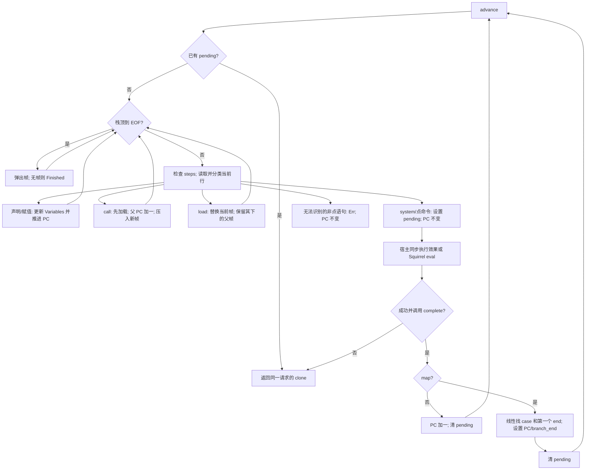

# NekoPack Runtime 深度技术审计

日期：2026-11-06。基线：`main`，`7d4d624c447db0415080c62a2ced8b3529bdd64f`。

本轮为只读审计，仅新增本报告。未修改源码、README、架构文档、历史验证报告，未新增或执行自编测试，未进行修复。下文的反例是依据代码推演的**待实现测试设计**，不是声称已经运行的崩溃复现。代码行号均对应上述提交。

## 1. 总体结论

**项目处于“已有较扎实资源解析基础的部分脚本运行时 / Headless 原型”阶段。不是完整游戏运行时，也不是 Android 可运行应用。**

资源解密、索引、嵌入 PNG 解码和明确指定图层的 CPU 合成具有实际测试及历史差分证据。标题链路确实运行了 Squirrel 模块、调用菜单闭包、进入剧情文件并建立下一层调用栈；没有发现这条路径完全由硬编码输出替代实际执行。

但当前不能把共享系统桥视为安全的通用脚本执行环境。静态审查确认了 **6 项 P0**：协程上下文空指针、字符串格式化内存越界、整数运算 UB、挂起被当成完成、嵌套 map 错选分支、系统脚本执行缺少可中断预算。另有会导致宿主进程终止的公共变量状态不变量问题、Android 目标构建缺失、编码语义变化及测试假阳性风险。现有通过记录没有覆盖这些路径。

建议先修复解释器安全与执行状态，再做 Android 原生调用验证；不建议直接把当前同步 `eval` 桥包装进 JNI 后开始显示游戏。DAT/PNG 算法无需因此推倒重写。

### 证据口径

- **E1：本轮实测**——运行已有测试或验证器，观察实际结果。
- **E2：代码确认**——完整追踪相关控制流，可以从代码直接推出结果；本轮没有新增动态复现。
- **E3：历史证据**——已提交报告及其生成代码；本轮未重跑该全量差分。
- **U：未知**——缺少原版、目标设备、故障注入或完整版本差分证据。

严重程度与证据方式不同：一个能从边界计算直接证明的栈越界仍为 P0，不因尚未运行 ASan 降级；反过来，未进行泄漏测量不能写成“已经发现泄漏”。

### 本轮实际执行

工作区起始干净，HEAD 与指定提交一致。使用现有 Windows GNU Rust 工具链、Zig 0.14.1，沿用仓库记录的 CXX/AR 参数运行：

```text
cargo test --workspace --quiet
cargo fmt --all --check
cargo clippy --workspace --all-targets -- -D warnings
python -m unittest discover -s research -p 'test_*.py'
python research/verify_title.py --fixtures .local/title-verified --cli target/release/nekopack-cli.exe --output NUL
```

结果：Rust/CLI 46 项通过（archive 13、CLI 7、image 15、resource 2、script 9）；Python 8 项通过；fmt、Clippy 通过；四部曲正常链路 4/4、非法选择 4/4 通过。`NUL` 为 Windows 空设备，没有覆盖历史 JSON。所用 release 二进制 SHA-256 与已提交 `title-verification.json` 一致。

没有重跑全部 DAT/像素差分，没有新建故障测试，没有执行 ASan/UBSan/泄漏工具、fuzz、Android 交叉构建或真机测试。因此不能报告这些检查“通过”。Clippy 也没有审计 C++ 内存安全，原生构建还主动使用 `-w` 关闭警告。

## 2. 问题清单

表中简写路径：`script/` = `crates/nekopack-script/`；`cli/` = `crates/nekopack-cli/`；`sq/` = `vendor/squirrel2/`。缺失能力与已确认缺陷分开描述；P1 缺失能力并不意味着原有静态工具实现错误。

| ID | 优先级 | 文件及位置 | 问题描述 | 影响 | 修复建议 | 证据 |
| -- | --- | ----- | ---- | -- | ---- | -- |
| F01 | P0 | `script/src/squirrel_bridge.cpp:21–23,44–46`；`sq/squirrel/sqvm.cpp:105,300–318`；`sq/squirrel/sqbaselib.cpp:189–196,788–800` | 子协程的 foreign pointer 为 NULL，原生变量回调直接读取 `c->variable` | 脚本调用原生变量入口可空指针解引用；同 OS 线程并不能消除此问题 | 明确协程支持策略；使用随闭包保存的受控上下文，或在确认不需协程的 profile 中显式拒绝创建；不能只修主 VM | E2；见 FFI 详细推演 |
| F02 | P0 | `sq/sqstdlib/sqstdstring.cpp:21,26–64,73,126` | format 校验写入固定 20 字节数组的边界错误；扫描 flags 未在 NUL 停止；64 位整数仍传给 `%d` 等 int 格式 | 栈缓冲区越界、越界读和变参类型不匹配 UB，入口已注册 | 按输出缓冲区容量检查每步读写；完整格式语法校验；按实际整数宽度构造格式/参数；增加 sanitizer 测试 | E2；不是仅凭版本年龄推测 |
| F03 | P0 | `sq/squirrel/sqvm.cpp:36–70,158–163,190–195` | 有符号加减乘、负号、比较相减及移位直接使用 C++ 运算；除/余只判断零 | 极值、负移位量或过大移位量可产生 UB；跨 CPU/优化级别结果不可靠 | 先确定目标数值语义，再显式实现溢出/移位边界；不能依靠当前编译器偶然行为 | E2；代码采用 `-std=c++11 -O1` |
| F04 | P0 | `script/src/squirrel_bridge.cpp:68–85`；`sq/squirrel/sqapi.cpp:952–969`；`sq/squirrel/sqvm.cpp:457–463,768–775` | `sq_call` 在 VM 挂起时也返回成功，桥未查 `sq_getvmstate`，直接清栈并返回 0 | 上层可能确认一个没有执行完的系统请求；挂起执行上下文被破坏，无恢复协议 | 在绑定策略落实前拒绝未支持的挂起；或返回明确 Suspended 状态、保留 continuation 并实现同线程恢复 | E2；见状态模型 |
| V01 | P0 | `script/src/runtime.rs:83–87,169–175,262–291` | map 扫描在第一个 `.end` 截止，不跟踪嵌套深度；每帧仅有一个 branch_end | 外层可命中内层 case，进入错误剧情；也可能错报重复 case 或丢失外层分支边界 | 先在执行前拒绝嵌套结构，或建立成对块边界与分支栈；不允许默默错选 | E2；有可逐行推导的反例 |
| F05 | P0 | `script/src/system.rs:119–139`；`script/src/runtime.rs:160–168`；`sq/squirrel/sqmem.cpp:5–7`、`squtils.h:10,99–103` | Rust steps 无法限制一次 Squirrel eval；没有原生堆配额/取消，原生分配失败也未检查 | `while`、递归/分配可挂死或终止宿主；原生 OOM 可进入 NULL placement-new/访问 | 增加 VM 执行与分配预算、取消及明确失败语义；本地测试超时不是运行器中断机制 | E2；外部 30 秒超时仅在 research 验证器存在 |
| F06 | P1 | `script/src/runtime.rs:11–13,57–60`；`script/src/system.rs:34–59` | 公共 names/slots 可由安全 Rust 调用构造不一致状态，get 使用索引并 panic | panic 发生在 `extern "C"` 回调内会终止进程，而非返回脚本错误 | 封装槽位不变量，受检构造/恢复；定义原生回调 panic 策略；优先消除正常可达 panic 源 | E2；触发前提是宿主破坏可公开修改的状态，不声称四部曲已触发 |
| V02 | P1 | `script/src/runtime.rs:143–145,262–300`；`script/src/system.rs:96–117` | 请求无 ID/代次；副作用失败不回滚，重试规则未定义 | 同步 CLI 当前不会重复确认，但将来旧异步完成可能确认新请求；重跑失败回调可重复写变量/效果 | 将请求 token 与完成绑定；明确 fail-stop 或重试/事务边界，再接异步设备 | E2；现有同步路径与未来风险分别界定 |
| V03 | P1 | `script/src/runtime.rs:169,231–251,274` | `.case` 只识别字面空格，而其它 token 使用 ASCII whitespace；map 行收集/分支识别不是同一语法 | `.case\t1` 无法匹配；空/异常点命令被当宿主请求而不是语法错误 | 共用词法规则；提前验证 map 结构与允许的宿主命令 | E2；不假定真实样本必然包含该形式 |
| B01 | P1 | `script/build.rs:6–10,39–79`；`script/src/lib.rs:5–6` | 构建不读取 HOST/TARGET/NDK/API；GNU 参数固定、无显式 PIC，parser 强制构建 C++ | `cargo --target` 本身不足以获得 Android 库；MSVC 不兼容当前参数；共享库接入未验收 | 隔离系统桥，目标感知编译/归档/链接，固定 ABI 与 NDK，验证最终 ELF | E2；没有证据证明 Android 已构建或必然不能构建 |
| C01 | P1 | `sq/HISTORY:1–39`；`sq/include/squirrel.h:44–79`；`script/src/system.rs:119` | 2.2.5 与 2.2.1 行为不同，当前整数随目标位数变化，桥变量固定 i32 | 默认参数、协程、生成器、GC、数值行为可能与原版不同 | 建立语言 profile 和原版差分；核实目标引擎编译配置，不把版本字符串当完整规格 | E2/E3/U；完整版本源码差分未完成 |
| C02 | P1 | `research/prepare_title.py:27`；`cli/src/title.rs:10–18,36–43`；`sq/squirrel/sqapi.cpp:566–571` | CP932 全量转 UTF-8，窄字符串长度/切片依然按字节计算 | 标识符可对应，但非 ASCII 文本长度、切片、排版与原版可能变化，不能直接作为生产脚本编码方案 | 保留资源名称原始字节；独立确认 Squirrel 字符串语义与显示解码边界 | E2；本地 `select.nut:38` 使用 `text.len()*11` |
| R01 | P1 | `crates/nekopack-resource/src/lib.rs:35–69`；`cli/src/title.rs:32–55,61–63` | Catalog 只是元数据来源分析，运行链路使用预解码目录，未实现 DAT→脚本生产资源管理 | 标题通过没有验证实际多包输入、缓存、SAF 与编码适配共同运行 | 保留 archive 算法，增加最小 GameSource/ResourceManager，CLI 先通过同一边界 | E2；缺失能力 |
| R02 | P1 | `cli/src/title.rs:36–44,63`；`crates/nekopack-image/src/pixels.rs:66–104,205–221` | 标题读取先全量 read 再检查 64 MiB，assets 无上限；像素预算只约束部分单个分配 | 文件/PNG副本、解码缓冲、RGBA、画布与原生 VM 叠加，Android 内存峰值无总约束 | 读取时限流；建立会话总预算与按需缓存；实测峰值而非相加预算当使用量 | E2；未进行 OOM 实测 |
| I01 | P1 | `crates/nekopack-image/src/canvas.rs:10–46`；`script/host/headless.nut:12–15,29–34,60–65,81–85,137–146` | 没有 MNG 动画调度、真实转场、图层生命周期、命中坐标/输入等待 | 静态合成无法支持持续游戏演出；headless 的确认与时间均为替身 | 建立共享场景/时钟/输入和目标设备渲染；保留 CPU 合成参考 | E2/E3；已知范围缺失，不能叫完整 MNG 播放 |
| S01 | P1 | `script/host/headless.nut:20`；`script/src/runtime.rs:116–125`；`CROSS_PLATFORM_ARCHITECTURE.md:93–97` | 没有存档实现；核心快照不足以包含 Squirrel globals、局部调用与宿主场景 | 当前变量共用不等于完整可恢复 GameState；无法跨平台保存/恢复 | 首先定义无活跃回调的安全点及可重建系统状态，避免原生堆转储 | E2；缺失能力 |
| T01 | P1 | `research/verify_title.py:33–56`；`cli/src/title.rs:89–103,155–173` | 断言到达首个剧情请求，不执行该请求；state hash 只记录、不对照；不校验注册键/帧内容/缺失 spot | 系统模块加载数量与出口对了，状态或效果仍可错误而通过；不能据此推断剧情可运行 | 明确边界；新增语义状态/注册/效果 oracle 与下一请求的预期类型 | E1/E2；当前报告范围总体诚实，但检测能力不足 |
| T02 | P1 | `research/prepare_title.py:9–18,27,34–44`；`script/host/headless.nut:128–139` | fixture 绕过 Rust DAT/目录层，生成 ID；MNG 同名 label 被字典覆盖；不绑定原包/参考实现哈希，输出目录可残留旧文件 | 改包/旧文件/重复素材可与实际输入脱节；缺失 Bind 被记录后继续，验证器不检查 | 记录来源与转换清单、拒绝不支持的重名、使用干净且受控输出，验证缺失资源与绑定 | E2；不表示本轮四款 fixture 已被证实错误 |
| T03 | P1 | `research/verify_canvas.py:35–84`；`verify_bootstrap.py:30–94`；`verify_config_scenes.py:28–44` | 关键验证依赖 Python assert | `python -O`/PYTHONOPTIMIZE 可移除对比仍产出“检查”报告，存在实质假通过路径 | 使用显式验证失败；记录解释器配置；加拒绝优化模式或对应测试 | E2；本轮正常模式未遇到此问题 |
| F07 | P2 | `script/src/squirrel_bridge.cpp:61–85`；`script/src/system.rs:90–93` | result 为 NUL 终止字符串且 lossy UTF-8；eval 失败时仍保留旧结果；非字符串返回变空串 | 二进制/含 NUL 结果截断，错误后可能误读上次结果；菜单当前使用整数文本未触发 | 明确类型/长度返回合同；错误使结果失效；不要把 debug string 当通用跨语言值 | E2 |
| R03 | P2 | `crates/nekopack-resource/src/lib.rs:39–68`；`nekopack-archive/src/lib.rs:160–166,197–203` | lookup 每次遍历所有 entry；Catalog 复制条目；索引字节预算不覆盖派生表 | 高频资源访问及多包索引会增加 CPU/内存；不是解析错误 | 按实测增加哈希索引、总索引预算；保留歧义，不以缓存顺序消解冲突 | E2 |
| V04 | P2 | `script/src/runtime.rs:122,126–133,160–168` | steps 可公开修改且仅用相等检查；max_depth=0 仍建立根帧；空行/扫描不计执行预算 | 宿主可绕过计数；边界合同不清楚，单次推进耗时没有上限 | 私有计数与受检构造；明确预算计数范围和单次推进工作量 | E2；与 F05 原生循环问题不同 |

没有为凑数量加入 P3 风格项。上表优先级按 Android 同进程运行游戏脚本的目标评估；第三方源码中的可达缺陷也属于产品风险。

## 3. FFI 专项审计

### 3.1 所有权、生命周期与线程：哪些设计成立

`SystemVm.raw` 私有，结构不实现 Clone；Drop 唯一调用 `neko_sq_close`。Context 与 result 在 C++ 分配并由 C++ 释放；Rust 从 `result/error` 复制为自有 String，正常路径未发现跨分配器释放、重复 free 或对外泄漏原生借用。

`eval` 的源字节和模块名借用仅用于同步编译调用；代码没有把 Rust 源指针保存在 Context。长度参数为 Rust usize/C++ size_t，变量值为 i32/int32_t。当前 64 位配置下相符；更换目标、宏或编译器后的 ABI 尚未测量。`length` 转 SQInteger 没有显式上限检查，也是后续目标构建需约束的输入合同。

`eval_with_variables` 的栈上 Binding 在同步 `eval` 期间存活，普通成功和 `Err` 都会执行解绑；包括模块名/源内 NUL 检查返回错误的路径。callback 返回的错误 CString 在 Binding 中存活，C++ 随即用 `sq_throwerror` 复制为 Squirrel 错误对象（`sqapi.cpp:916`），不是 VM 长期借用 Rust 错误指针。

`PhantomData<Rc<()>>` 使 VM 非 Send/Sync；`&mut self` 也排除安全 Rust 并发调用。当前没有 JNI 调用或 Rust 回调再进入同一 VM 的接口。普通同 VM 嵌套 Squirrel 函数在 callback 返回后再访问变量，没有证据显示同时持有两个 Rust `&mut Variables`。**Squirrel coroutine/thread 是同线程子 VM，不等于 OS 线程；F01 仍然存在。**

### 3.2 F01：子 VM 上下文丢失的完整路径

1. `sq_base_register` 暴露 `newthread`，创建调用 `sq_newthread`。
2. SQVM 构造将 `_foreignptr=NULL`。`Init(friendvm)` 复制 root table、errorhandler、debughook，**不复制 foreignptr**。
3. 原生 `NekoVariableGet/Set/def` 闭包位于共享 root table，因此子 VM 仍可调用它们。
4. `variable_call` 从当前子 VM 取 foreignptr，立即执行 `if(!c->variable)`，此时先解引用了 NULL，而不是返回“未绑定”。

待新增测试设计：在绑定有效时，由 `newthread(function(){ ...读取一个已声明变量... })` 执行回调，要求得到受支持值或明确“不支持协程”错误，不能崩溃。还需覆盖解绑后唤醒及 VM 销毁。这里没有把该测试写入仓库或执行。

编译错误 handler 也依赖当前 VM foreignptr，未来任何对子 VM 使用 raiseerror 编译的入口都需要一并处理。当前 `compilestring` 使用 SQFalse，不能仅凭共享 handler 就宣称其当前错误路径必然触发相同崩溃。

### 3.3 F02：格式化内存安全的算术证据

`fmt` 容量为 20；`validate_format` 仅在 `n-start > 20` 时拒绝。若转换说明符前有 20 个合法 flag 字符（例如重复 `-`），差值为 20，检查放行；随后从 `fmt[1]` 复制 21 字节，并写 `fmt[22]='\0'`，明显超出 `[0,19]`。

flags 循环调用 `strchr("-+ #0", src[n])`，没有先排除 `src[n]==0`。C 字符串查找 NUL 会返回终止符地址，因此带实参的尾部不完整 `%` 格式也可能越过源字符串继续读取。两者都是从实现直接推导的边界问题，不需要猜测分配器布局。

另外 `SQInteger` 在当前 _SQ64 为 long long，但 `%d/%i/%u/%x` 等格式仍直接把该值作为变参传给 sprintf；即使小数字在 Windows 测试中表现正常，也不是正确的变参类型合同。修复不能只扩大局部数组。

### 3.4 F03、F05、F06：UB、内存预算与 panic

整数负号的最小值、最小值除以 -1、有符号溢出、负数/超过位宽的移位量均没有边界处理。变量入口把赋值限制为 i32，**不能限制 Squirrel 自身中间表达式**，因此并未消除这些 UB。原版是何种宽度、溢出是否要求回绕尚未知，应先确定 profile。

`new Context` 使用本项目全局 new，分配失败 abort；Squirrel 多数对象却经 `SQ_MALLOC/SQ_REALLOC` 直接使用 malloc/realloc，失败未检查。`sqvector::_realloc` 覆盖旧指针后继续使用，失败也可能丢失原分配。不存在可恢复的 OOM 合同，更没有会话配额。正常测试通过不是故障注入证据。

`Variables.names` 可公开插入 Slot 而不创建对应 slots，随后 callback→get 的索引 panic。Rust 普通 `extern "C"` 边界不允许 unwind，当前后果应描述为**进程 abort 风险**，而不是笼统声称 Rust 异常已经穿越 C++ 栈。避免此路径的首选是封装变量不变量；不能把所有错误宽泛吞掉后返回 0。

### 3.5 错误返回、挂起、重入和销毁

普通编译/运行错误会恢复 Squirrel 栈顶并返回 String；但变量与全局表修改已经发生，不会回滚。调用者不能假定“Err 意味没有副作用”。本轮现有测试覆盖若干错误之后继续调用，未覆盖“写变量后抛错再重试”的语义。

Squirrel 语言错误通过返回值/错误对象处理，构建禁用 C++ exceptions；未发现正常路径把 C++ throw 跨 C ABI 传播。compiler 使用 setjmp/longjmp，当前没有从编译器 longjmp 越过活动 Rust callback 的证据；这也不能替代对第三方实现的 sanitizer 审计。

F04 另属状态错误：Squirrel 明确允许 `sq_call` 成功且 `_suspended=true`，桥未读取状态。单纯恢复栈顶不是恢复调用栈。当前没有 wakeup 接口、continuation 所有权或挂起期间状态绑定合同。不能用现在的栈上 Binding 指针去支撑异步恢复。

正常 Drop 先关闭 VM，再 free result、delete Context；`sq_close` 与 `SQSharedState` 析构会清理 root、默认委托、引用表与 GC 链（`sqstate.cpp:161–215`）。没有证据证明普通关闭必然泄漏，也没有泄漏检测证明无泄漏。原生 OOM、异常挂起、子协程和长时间运行均未验证；重复 new/drop、循环引用、错误后销毁应补测。

“Rust Variables 是唯一状态来源”的准确范围是：**由内置 var 代理访问的已声明数值槽**。Config、StoryRoute、对象和闭包等仍在 Squirrel；脚本还可重新赋值 root 中的 var/native 名称。它不是不可替换的安全边界，更不等于整个游戏状态已由 Rust 管理。

## 4. 脚本 VM 专项审计

### 实际执行流程



图中“等待”只是宿主尚未 complete 的请求，不存在 WaitInput/WaitAudio/WaitAnimation 等真实异步调度状态。

### 指令边界与逐项结论

- 解析器支持 `.def name integer`、`.var G/L地址 names...`、`.call`、`.load`、`.system`、`? name = integer` 及已观察到的无间隔 `?name = integer`。不支持一般表达式、标签跳转、对白、任意条件判断。
- `.call` 先成功加载再把父 PC 加一，随后压栈；子文件 EOF 才弹出。加载失败保持 PC，错误仍消耗一次 steps。最大深度对后续压栈有效；根帧不受 max_depth=0 限制。
- `.load` 只替换栈顶，所以被 call 的脚本 load 新文件后，后者 EOF 仍返回更低的父帧。单元测试验证了当前实现的一条路径，**未证明与原版所有 load/return 语义一致**。
- 重复 advance 遇 pending 不增加 steps，也不会自行再执行宿主副作用；宿主若重复 dispatch，同一请求会再次发生副作用。complete 后尚无新 pending 时重复 complete 会报错；产生新请求后，旧完成结果没有 token 可区分。
- 非 map complete 拒绝 Some(result)；map 在验证结束前不修改 PC/pending，因此现有“错误选择后重试正确选择”测试有效。但 callback 已发生的写入不回滚。
- 未知非点语句返回 Err。未知点命令被委派给宿主；标题 CLI 通过不存在的 com key 报错。**Machine 自己不能保证所有未知点指令都停止**，测试中的 `.done` 也是通用请求。
- 预算约束正常 Rust 语句循环，`.load self` 会逐步耗尽；空行、文件复制、map 扫描以及一次 Squirrel eval 不受该步数预算的工作量约束。公开修改 steps 可绕过相等检查。不存在实际运行的“无限循环安全”测试。

### V01 静态反例

下面仅为待新增测试设计：

```text
.map outer
.case 1
    .map inner
    .case 2
        .wrong
    .end
.case 2
    .right
.end
```

外层返回 2 时，当前 complete 从上向下扫描，把内层 `.case 2` 当成外层目标，在内层 `.end` 截止，接下来产生 `.wrong` 请求，而不是 `.right`。这是错误执行，不只是“缺少嵌套支持”。若暂不支持嵌套，应在执行外层菜单效果之前明确拒绝这种结构。

单个 branch_end 也不能表达两层活动分支；当前测试只有一个 map。`.case` 的 tab 分隔问题与此独立，应通过统一词法而不是增加另一个字符串前缀特例解决。

### 首段剧情边界的真实含义

四部曲进入 story1，执行 route 与部分赋值、call，随后在子脚本的首个非 route 请求**执行前**停止。BLESS/BLACK 为 P01，BIRTH 为 012401，BRAVE 为 010901，深度均为 2。这个边界有价值，但没有证明该请求可执行、能够显示第一句对白，或剧情中的调用最终能正确返回。

## 5. Squirrel 2.2.1 / 2.2.5 兼容性

原版 2.2.1 目前来自前序研究的版本字符串记录；本轮未重新核验四个 EXE，也未取得并逐行比较完整 2.2.1 源码。厂商可能修改解释器和宿主 API，因此“2.2.1”仍是待确认 profile，而非既定二进制兼容目标。

随包官方 `vendor/squirrel2/HISTORY:1–39` 给出了不能忽略的差异：

| 版本 | 有记录的变化 | 对本项目的意义 |
| --- | --- | --- |
| 2.2.2 | thread.call/wakeup 行为、协程错误传播、native 返回值、sort 错误处理修正；新增 array remove/insert API | 同样脚本在异常、协程、排序路径不能假定完全相同 |
| 2.2.3 | getfunctioninfo、SQUSEDOUBLE、_floatsize_；wakeup 支持异常恢复；sqstd_format；generator call、模零与负常量修正 | API/调用语义及数值配置需要版本化，不是只替换库文件 |
| 2.2.4 | 默认参数函数错误修正 | 当前系统脚本使用默认参数，标题路径只覆盖其部分组合 |
| 2.2.5 | class/instance getsize、_newmember isstatic 参数、heapsort、科学计数法、GC 与 double 配置修正 | 反射、元方法、排序及对象生命周期与旧版本存在差异 |

这不是完整差分列表。标准库方面当前只注册基础库和 string/regexp，未链接标准 math/io/system/blob 的实现；游戏宿主通过 headless 定义了部分同名能力。函数“能编译”不说明其内部调用的 API 存在。

已验证的是这套 2.2.5 + 当前宿主在特定输入下：类/继承、闭包注册、表与数组操作、若干 regexp/format、菜单函数、变量回调和部分默认参数能完成标题路径。未验证的是完整异常/生成器/协程/弱引用/GC 压力、任意系统命令、原版存档与 2.2.1 全语义等价。

当前 `_SQ64` 由 `_WIN64/_LP64` 选择；SQInteger 为 64 位，SQFloat 默认 float。原版整数/float/字符编译配置未知。自有 C ABI 是本项目的接口，并不是复用原版 Squirrel 二进制 ABI；各目标重新编译同一源码是可行方向，但必须对宽度、符号、对齐和返回状态独立验证。

编码方面，fixture 的 CP932→UTF-8 转换使两边变量名称一致，但 Squirrel 窄字符串 `.len()` 返回字节数。一个原 CP932 双字节字符转换成 UTF-8 后可能为三字节；本地脚本确有 `text.len()*11` 的布局表达式。不能把 UTF-8 视为无语义影响的透明迁移。商业脚本仅在本地查看，没有复制进报告或仓库。

## 6. 资源、图像与跨平台架构

### 6.1 资源读取

`Archive<R: Read+Seek>` 不依赖平台路径；u64 偏移、索引预算、索引与块长度匹配、key parity、截断检查、64 KiB 流式解码与任意调用切分均有代码及测试依据。`copy_entry` 要求 &mut self，安全 Rust 下同一对象的 seek/read 不会无锁并发；多独立 reader 或加锁适配才是并发读取方案。没有发现本次可确认的 DAT 越界内存访问。

注意 parity 是 seed/length 校验，不是 payload 内容 checksum；DAT 内容损坏不一定在 archive 层被发现。PNG/MNG CRC 提供的是其自身块校验，不能扩写成所有资源完整性验证。源保持不变是显式合同，文件被外部修改后的快照一致性未实现。

Catalog 对不同 seed 分别计算名称哈希，保留 source/ordinal；最高优先级是明确策略，同优先级包括包内重复会报告歧义，这比任意选择更可靠。但哈希匹配不证明名称唯一，且没有原版覆盖次序 oracle。它尚不持有包 reader、缓存、失效状态或 SAF 描述符，不能独立承担实际 ResourceManager。

### 6.2 PNG、Alpha 与 MNG

RGBA8 解码、palette/gray/alpha/Adam7 与导出具有合成样本和 Pillow 差分。16-bit、APNG 及部分 MNG 像素依赖显式拒绝。合成采用 straight-alpha 的 source-over、带符号坐标裁切和整数舍入，不做 gamma/ICC 转换；RgbaImage 内部尺寸/像素字段不公开，当前入口维持布局不变量。

Mng::parse 验证帧结构、CRC、主要字段长度/值，保留未知块；FRAM/DEFI/TERM 是**元数据**，不是运行中的对象/动画状态。sprites 限定 object 0、可见、abstract、mode 2 与未变 timing/clipping；其它组合多数显式拒绝。TERM 重复/结束、帧延迟、循环、对象生命周期并未执行。官方 MNG 规格将这些行为作为播放语义，不能以 84 个文件解析成功替代播放器。[MNG 1.0 规范](https://libpng.org/pub/mng/spec/)

静态合成历史结果覆盖 252 组“首图+末图 × 三种底色”，不是 3,072 图像的全部图层组合或动画帧。BLESS 原版显示比较使用 JPEG、裁剪 ROI，报告本身明确无法测无损逐像素一致；另外三款静态 config 配方不是三个原版截图。

PNG 重组会复制压缩数据；RGB→RGBA 时解码缓冲与输出缓冲同时存在，另外还有原 MNG 与画布。64 MiB 参数不能作为进程峰值内存上限。报告中的约 528 MB 是累计对比 RGBA 字节量，不是单帧内存。

### 6.3 架构可落地性

保留 Rust 资源算法、统一 VM 和薄平台宿主的方向合理；目前没有必须重写 archive/image 才能支持 Android 的证据。Windows 与 Android 可以使用同一套源码 VM，但尚无跨目标语义一致的设备证据。

C++ 是迁移风险，不是跨平台的逻辑禁令。当前 build.rs 可以通过环境手动传入工具，却没有建模 Android target/API/sysroot/PIC/C++运行库与链接合同。NDK 官方要求选择对应目标工具链/target，而不是只更换 Rust target。[NDK 外部构建指南](https://developer.android.com/ndk/guides/other_build_systems)

JNI 还不存在，不能评为“已正确”。应让会话由一条 Rust 引擎线程拥有；UI 线程投递输入/生命周期，不共享 JNIEnv 或裸 VM 指针。native handle 的销毁与待处理工作、错误对象的跨语言复制、暂停/取消都要明确。当前单次同步执行整段 .nut 和架构中的 cooperative advance 之间仍有实施缺口，需要选择可取消的引擎线程等待，或真正支持挂起/恢复；不能让 UI 线程直接阻塞 eval。

SAF 不构成必须重写解析器的障碍，但它可能提供 pipe，或 asset 子段。应建模描述符所有权、起始 offset、长度、seek 能力、撤销授权及缓存上限；不能用 content URI 拼路径。dup 出来的文件描述符也不能简单当成彼此独立的 seek 游标。官方文档明确只读模式可返回 pipe/socket，调用者负责关闭描述符。[ContentResolver](https://developer.android.com/reference/android/content/ContentResolver)

规划文档已说明模块在真实实现时建立，暂未出现九个空 crate 的实际负担。无需现在抽取跨引擎公共框架。旧架构的 ReadAt 与新方案保留 Read+Seek 是设计演进而非现有代码冲突。存档仍是高风险设计空白：只保存 Rust 数值槽不够，Squirrel 全局状态重建必须一起验收。

## 7. 测试可信度审计

| 对象 | 证据等级 | 可以相信什么 | 不能推出什么 / 假通过风险 |
| --- | --- | --- | --- |
| 13 archive tests | 本轮 E1 | 实际执行 Rust；固定外部参考向量不是运行时自己加密再解密；含大于 4 GiB 的合成 seek、截断、流式写错 | 不是全部游戏资源、全部 DAT 版本或真实超大磁盘文件实测 |
| 2 resource tests | 本轮 E1 | 多 seed、最高优先级和同优先级歧义按当前策略执行 | 原版补丁策略、哈希无碰撞、完整挂载与缓存 |
| 15 image tests | 本轮 E1 | 解析/解码/合成真实调用，固定像素、CRC、截断与预算有断言 | 动画播放器、GPU、原版颜色空间 |
| 7 CLI tests | 本轮 E1 | 启动真实测试二进制，检查字节/元数据/错误输出，不仅退出码 | 没有公共 run-title fixture；不覆盖整个 Squirrel/VM 失败面 |
| 9 script tests | 本轮 E1 | 4 parser、2 runtime、3 system；别名/错误后调用/单层 map 有断言 | 不是 9 个完整 VM 场景；缺嵌套、协程、挂起、溢出、OOM、取消、panic/drop 压力 |
| 8 Python unit tests | 本轮 E1 | 6 项 Phase0 检查辅助函数，2 项 sprite 选择/差异指标 | 不调用 Rust cipher/VM；PlainDecoder 是明确的明文 fixture，不是假装真实解密 |
| 四部曲标题验证 | 本轮 E1 + 历史 E3 | 真实 .nut 执行与受限宿主；指定开始项、route/call 到已知边界；非法 999 被拒绝 | 其它合法选项、禁用项、真实鼠标/触摸、第一句对白、声音、系统状态全量正确 |
| DAT 差分报告 | E3 | 22 DAT、51,201 条目的索引/元数据/前缀；完整载荷为选定分层样本 | 51,201 个完整资源全部解码正确；所有文件损坏均检测 |
| MNG metadata 报告 | E3 | 84 MNG、27,712 块的 framing/CRC/raw 字节比对；hash/覆盖策略核对 | 所有 FRAM/TERM 解析字段的原版语义或动画时间线；raw 字节保留不等于解析语义完备 |
| PNG pixel 报告 | E3 | 3,072 嵌入 PNG 与 Pillow RGBA 比对；同时检验记录头、EOF、退出码，84 次 PNG 导出 | 完整 MNG 播放、原版渲染；Pillow 也不是原版引擎 oracle |
| canvas/config 报告 | E3 | 选定配方对 Pillow；config 的 17 状态/8 选中是明确研究配方 | 游戏逻辑自动生成同样画面；headless 图层计划与这些像素配方已接通 |
| bootstrap 报告 | E3 | 12 脚本、91 语句的静态 AST 范围与直接依赖 | 完整 VM 语义；正则注册扫描不是实际注册，且不能可靠排除多行注释 |
| Android / JNI / ARM64 | U | 无本仓库设备运行证据 | 编译通过、生命周期安全、图形/音频正确或可安装应用 |

### 假通过风险的准确界限

1. `verify_title` 固定游戏名/预期子脚本/模块数作为 oracle 是合理的测试预期，不是实现硬编码成功；但它不验证首请求的内容，也不比较完整状态 hash、效果与注册键，存在漏检。
2. 合法选择只测 1，负例只测不存在的 999；它没有证明“存在但禁用的项”不可选，更没有交互命中测试。
3. fixture 通过外部 portkit 解包并预先生成素材几何，当前 Rust DAT/MNG 不参与 run-title。两条验证各自有价值，却不能当成端到端资源运行证明。fixture hash 记录的是当前内容，没有自动对照批准版本；生成器未验证原包 hash、参考工具 hash 或清理遗留输出。
4. `bank[label]=...` 会丢弃重复 MNG 名称，而 Rust sprites 测试刻意保留重复项。两边输入模型并不相同。研究生成器必须声明或验证其子集。
5. Python -O 会删除 assert；这一风险涉及几个差分脚本，**不涉及使用显式 require 的 archive/pixel verifier 或显式 passed 判断的 title verifier**。本轮没有用 -O，不能据此否认已有正常模式报告。
6. 未采集代码覆盖率，不能把测试数量写成覆盖率百分比。大量格式/语义仍未覆盖，编译器成功也不提供对应证据。

### 仅建议、尚未新增的测试

优先补：子 VM 变量访问；恶意/截断 format；整型边界与移位；挂起和恢复/拒绝；两层 map；public state 不变量与 callback panic；写入后抛错；旧请求完成；有限循环预算、无限循环取消与 OOM；NUL 结果及失败后旧结果；VM 反复销毁与 GC 环；非 ASCII 字符串长度/切片；真实 DAT 同输入轨迹；SAF 非 seek/子段/权限撤销。崩溃、无限循环、OOM 测试必须在受限子进程及 sanitizer 环境执行，不能直接卡住 Android UI。

## 8. Android 落地风险与具体步骤

从当前仓库到 ARM64 最小可运行原型应按以下顺序，不能把最后一步“发布 APK”当作前几步的替代验收：

1. **固定执行安全合同。** 修复 F01–F05/V01，封装变量不变量；明确不支持的语言特性会报错、请求不会被错误确认。先完成桌面已有 harness 的故障测试。
2. **隔离 native bridge 构建。** parser-only 不需要 C++；固定 Squirrel 源码/profile、NDK/API、CRT、PIC、符号可见性和归档器。移除依赖宿主编译器默认 target 的做法；验证 ELF 架构与动态依赖。全局 new/delete/`__cxa_pure_virtual` 的符号是否影响其它 native 库也需在链接阶段检查，而非假定安全。
3. **ARM64 原生烟测。** 先运行最小 native harness 或测试宿主，验证初始化、变量读写、普通错误、取消、重复销毁及数值/字符串行为；这里还不需要游戏 UI。设备实际返回轨迹才是运行证据。
4. **最小 JNI 会话。** Kotlin 创建/关闭会话和发送事件，Rust 引擎线程拥有 VM；JNI handle 代次与关闭顺序明确。验证前后台、退出与错误回传，不让回调在错误线程访问 VM。
5. **资源接通。** 本地文件适配先接真实 DAT/catalog，再加 SAF；对相同样本验证读取字节/选包来源/脚本轨迹一致。实现编码合同、seek/子段读取与缓存上限。
6. **一条真实交互链。** 最小共享 renderer 显示标题，触摸经 viewport 转为动作，完成事件按 token 返回。随后显示一段实际剧情/文本并验证音频等待；在此之前不要称为 Android 游戏运行时。

wgpu 仍是候选，当前报告不新做选型或增加后端。现有架构能承载这些步骤，但旧迁移估算没有包含本轮确认的 vendor 安全修复与语言 profile 验证，不能继续把“几天构建接通”当成完整可用系统桥的工期。

## 9. 修复优先级与依赖


每一步单独提交与验收。先约束 native 支持范围，再处理异步调度；先修 map 结构，再扩大剧情覆盖；先确定源与状态 oracle，再用其判断 Android 行为。不要同时改解密、VM 控制流、编码和渲染，否则无法定位差异来源。

不能通过关闭错误检查、跳过未知命令、把协程变量读成零或将所有异常吞掉来“修复”四部曲通过率。对于尚未支持的挂起/嵌套语法，明确拒绝优于错误执行，但必须如实列出兼容范围。

## 10. 未来三个开发阶段

| 阶段 | 目标 | 修改范围 | 验收条件 | 前置依赖 | 预计风险 |
| --- | --- | --- | --- | --- | --- |
| 1：执行内核安全与确定性 | 把当前可达 P0 路径变成受控行为 | vendor 必要安全补丁、FFI、Variables、Machine；仅按依赖逐批改 | 新设计的故障测试在子进程可复现并修复；ASan/UBSan 无对应错误；嵌套结构正确或预先拒绝；取消/预算生效；四部曲既有状态轨迹不退化 | 用户批准修复；确认语言/profile 和挂起支持策略 | 高：旧解释器隐藏缺陷、数值行为与原版可能冲突 |
| 2：同一核心在 Android ARM64 执行 | 证明实际目标构建与会话调用成立 | native crate/build、最小 JNI/线程会话、资源输入适配与编码；保持单一 VM | ARM64 设备运行初始化/读写/错误/销毁；真实 DAT 与桌面轨迹一致；SAF 能力不足显式处理；关闭/暂停无悬挂调用 | 阶段 1；可用 NDK/设备、可靠 oracle | 中高：C++ ABI、生命周期、SAF provider 和字节编码 |
| 3：Android 最小真实剧情切片 | 从无窗口验证转为实际交互与演出 | 共享场景、输入、文本、最小渲染/音频与等待；安全点状态重建 | 真实标题点击进入约定剧情，文字/图层/声音实际输出；前后台恢复稳定；明确支持范围与内存峰值；随后验收安全点保存恢复 | 阶段 2；确认首段剧情所需指令及素材行为 | 高：MNG 时序、文本编码/排版、系统脚本宿主 API 覆盖 |

Windows、Linux/Steam Deck 图形产品仍在 Android 原型之后；桌面现有 CLI 继续作为同一核心的验证工具。当前没有必要为理论上的多平台抽取另一套 VM 或重写已经验证的资源算法。

## 11. 审计边界与待确认事项

本报告不证明 vendor 的全部约一万行代码已无其它漏洞，也未给出 CVE 对应关系。已确认问题来自具体实现，不依赖“旧软件必然不安全”的泛化判断。未知项包括原版完整语言配置、所有四款引擎版本、GF 位存储/自动解锁语义、load 的原版全行为、泄漏和长期 GC、ARM64 运行、GPU/音频设备行为及跨平台存档。

结束校验：逐一比较审计前后 111 个已跟踪文件的 SHA-256，全部一致；git status 仅新增本报告。没有提交或推送。后续修复须等待用户确认。保留全部已有验证结论的原始范围，不将本轮发现覆盖写入历史 JSON。
